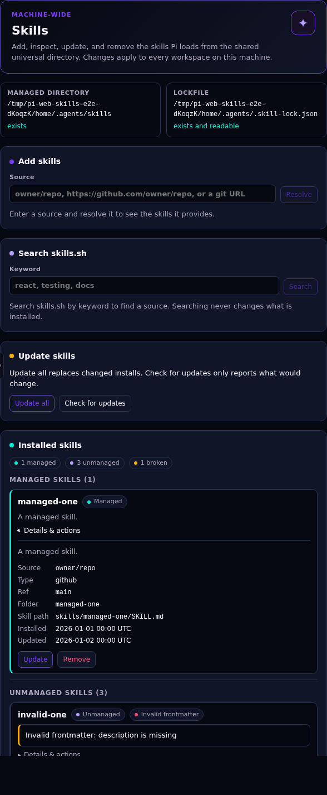

# pi-web-skills

A PI WEB panel for managing the agent skills that Pi loads from `~/.agents/skills`.

**Status:** implemented (v1). The package ships a browser panel and a session-daemon
server entry. Upstream skills.sh behavior is the contract; the panel never runs the
`skills` CLI at runtime.



## What the panel does

The panel is hosted in a workspace but manages machine-wide state; it never reads
or writes workspace files. PI WEB's public plugin API has no Settings-pane
contribution, so a Settings tab would require a PI WEB core change.

It shows a machine-wide notice and the resolved managed directory and lockfile:

- managed directory: the session-daemon user's `~/.agents/skills`;
- lockfile: `$XDG_STATE_HOME/skills/.skill-lock.json` when `XDG_STATE_HOME` is set,
  otherwise `~/.agents/.skill-lock.json`.

Five operations:

- **List** every present skill as **managed**, **unmanaged**, or **broken**, with
  source, ref, plugin, and update time for managed rows. A skill with invalid
  frontmatter is marked, not hidden. The list is read-only and re-reads state on
  every page load.
- **Add** from a GitHub shorthand, a GitHub or GitLab URL, or a generic git URL.
  Resolve the source first, then select one, several, or all discovered skills.
  Replacing an existing folder requires an explicit overwrite confirmation.
- **Search** skills.sh by keyword and start an Add from a result. Results can
  be dismissed.
- **Update** every managed install by comparing the remote folder hash at the
  locked ref. **Check for updates** is a read-only preflight: it reports
  available, unchanged, skipped, deleted, and failed entries without copying or
  writing anything. Its results can be dismissed, and the available skills are
  ticked so you can **Update selected** or **Update all**. An update asks first
  and states that a remote change replaces the installed folder and can
  overwrite a local edit. Changed and relocated skills are replaced; unchanged,
  skipped, deleted-upstream, and failed entries are reported separately.
- **Remove** a managed install and its lock entry, or remove only the stale lock
  entry for a broken skill. Remove always asks first.

Unmanaged skills are read-only for Update and Remove. Add may replace an unmanaged
folder only after the overwrite confirmation. Every operation is safe to retry:
cancelling Add or Update stops the work, and an Update that fails during a copy
leaves the install it was replacing intact.

After an install, update, or removal that changed a directory, the panel shows a
dismissible reminder to run `/reload` in each idle Pi session. The panel never
reloads sessions itself.

## Install

### Requirements

- PI WEB with browser and server plugin API v5. Both first shipped in
  `@jmfederico/pi-web` 1.202610.5; tested against 1.202610.6.
- Node.js 22.20 or newer to build the package.
- `git`, plus a PI WEB session daemon running as the user whose skills you want to
  manage.

The package is published to npm after a maintainer approves each staged release.
Install it as a Pi package:

```sh
pi install npm:pi-web-skills@0.3.0 # x-release-please-version
```

Or install it from a source checkout:

```sh
git clone https://github.com/elementalvoid/pi-web-skills.git
cd pi-web-skills
npm install
npm run build
```

Register the built checkout with PI WEB in one of two ways.

### A. Pi package (recommended for a stable install)

- Open **Settings → Pi packages** and add the absolute path to this checkout.
- Or from a shell:

  ```sh
  pi install "$PWD"
  ```

### B. Local plugin directory (fastest for development)

```sh
PLUGIN_DIR="${PI_WEB_DATA_DIR:-$HOME/.pi-web}/plugins"
mkdir -p "$PLUGIN_DIR"
ln -s "$PWD" "$PLUGIN_DIR/pi-web-skills"
```

The symlink name must match `^[a-z][a-z0-9.-]*$`; `pi-web-skills` qualifies. PI WEB
reads local plugins from `$PI_WEB_DATA_DIR/plugins`, which defaults to
`~/.pi-web/plugins`.

Then:

1. Restart the session daemon once so the server entry loads. On a native systemd
   user install, that is `systemctl --user restart pi-web-sessiond`. For other
   deployments, see [Restarting the session daemon](CONTRIBUTING.md#restarting-the-session-daemon).
2. If **skills** is not enabled, turn it on under **Settings → PI WEB plugins**.
3. Reload the browser page. Open a workspace and select the **Skills** tab, or run
   **Open Skills** from the action palette.

The panel manages the home directory of the user running the session daemon:
`~/.agents/skills` and the global lock. If the daemon runs in a container, that is
the container user's home; mount or persist it if installed skills should survive
container replacement.

For a development loop with local changes, see
[docs/local-development.md](docs/local-development.md).

## V1 limits

- **Global only.** One managed directory and one lockfile. No project installs, no
  `skills-lock.json`, no workspace-scoped skills.
- **No new install model.** Add, list, update, and remove follow upstream
  skills.sh semantics. No pinning, candidate scanning, drift detection, sidecars,
  or extra lock fields. Unknown lock fields are preserved.
- **Pi-only.** Installs target the shared universal directory and create no
  symlink into another agent's directory.
- **No restore.** A broken entry is cleaned up by removing its stale lock entry;
  there is no global restore.
- **No adoption.** Unmanaged skills cannot be updated, removed, or adopted.
- **No automatic reload.** Skill changes need `/reload` in each idle session;
  server-module changes need a session-daemon restart.
- No local directory sources, well-known skill URLs, archives, direct file
  downloads, or hosted artifact URLs.
- No telemetry and no network calls except git operations, GitHub tree lookups,
  and skills.sh search. GitHub authentication comes from the daemon environment
  (`GITHUB_TOKEN` or `GH_TOKEN`) and, for tree lookups, the `gh` CLI; there is no
  token UI.

## How it runs

A PI WEB plugin package with:

- a **server entry** in the session daemon, which owns filesystem and git work and
  exposes peer requests and Add/Update channels;
- a **browser entry** contributing one machine-scoped workspace panel. The browser
  bundle uses the host-provided `html` template tag; it does not bundle Lit.

The plugin has no settings in v1. See [Install](#install) for setup.

| Change | Action |
| --- | --- |
| Browser bundle / panel | Rebuild and reload the page |
| Server module (`dist/server.js`) | Rebuild, restart the session daemon, reload the page |
| `package.json` `piWeb` metadata | Restart the session daemon, reload the page |
| Installed skills | `/reload` in each idle Pi session |

## Development

```sh
npm install
npm run build
npm run typecheck
npm test
```

`npm test` runs the Node test suite: path resolution, list classification,
lockfile, add, update, remove, search, parity against the real `skills` CLI, and
the panel adapters. Tests use temporary HOMEs and local git fixtures; they never
touch the real `~/.agents` state or the network.

The real-browser smoke test is separate:

```sh
npm run test:e2e
```

Install Chromium first if Playwright does not have it cached
(`npx playwright install chromium`). The command builds the package, starts an
isolated PI WEB instance (temporary `HOME`, `PI_CODING_AGENT_DIR`,
`PI_WEB_DATA_DIR`, session socket, and free port), opens the panel in Chromium,
and exercises list states, Add from a local `file://` git fixture, Remove, broken
cleanup, and Update's confirmation. It never touches a running PI WEB instance or
its data directory. See [docs/local-development.md](docs/local-development.md) for
prerequisites and the manual checklist.

The vendored subset comes from
[vercel-labs/skills](https://github.com/vercel-labs/skills) (MIT, Copyright (c)
2026 Vercel, Inc.); see [docs/upstream-parity.md](docs/upstream-parity.md) for the
pinned commit and file list. `skills@1.7.4` is a dev dependency used only for
parity fixtures.

## Contributing

See [CONTRIBUTING.md](CONTRIBUTING.md) for development setup, the session-daemon
restart guide for native and container installs, and the manual UI checklist.

## Decisions

- [ADR 0001: Global installs only](docs/adr/0001-global-only-v1.md)
- [ADR 0002: Upstream parity through a thin reimplementation](docs/adr/0002-upstream-parity-thin-reimplementation.md)
- [ADR 0003: "Pi-only" means the universal directory](docs/adr/0003-pi-only-uses-the-universal-directory.md)
- [ADR 0004: Update follows upstream](docs/adr/0004-upstream-update-semantics.md)
- [ADR 0005: Check for updates is read-only](docs/adr/0005-read-only-update-check.md)
- [Vocabulary](GLOSSARY.md)
- [Verified upstream behavior and vendoring plan](docs/upstream-parity.md)
- [Local development and testing](docs/local-development.md)
